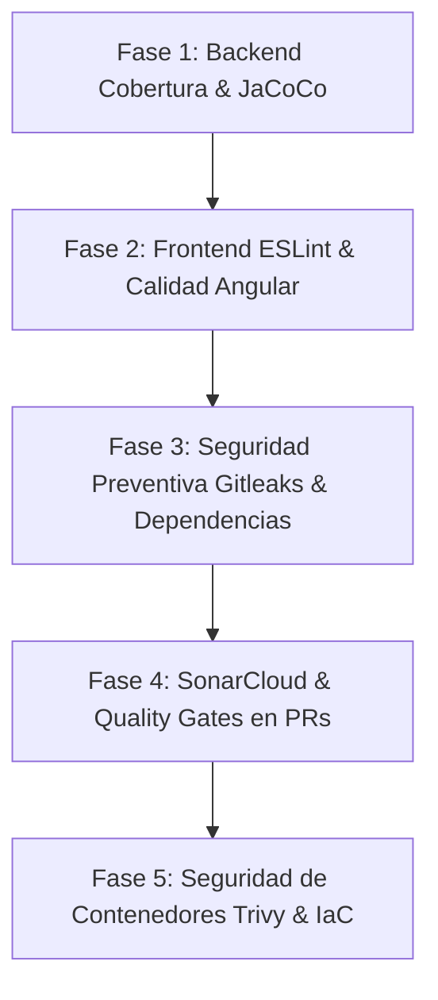

# 🛡️ PLAN DE IMPLEMENTACIÓN: CONTROL DE CALIDAD Y SEGURIDAD EN CI/CD
**Plataforma Sísmica de Centroamérica — Fozna Solutions B.V.**

---

## 🎯 Objetivo General
Elevar la madurez técnica del pipeline de GitHub Actions (`.github/workflows/deploy.yml`) incorporando análisis estático de código (SAST), análisis de composición de software y dependencias (SCA), control de cobertura de pruebas unitarias, detección preventiva de fugas de secretos y validación de seguridad en infraestructura (IaC y Docker).

---

## 📊 Matriz de Herramientas Seleccionadas

| Dominio | Herramienta | Función Principal | Nivel de Impacto |
| :--- | :--- | :--- | :--- |
| **Backend (Java 21)** | **JaCoCo** | Cobertura de pruebas unitarias y umbral mínimo de build | Alto (Fiabilidad) |
| **Backend (Java 21)** | **SpotBugs + FindSecBugs** | Detección de fallos en bytecode, fugas de memoria y NPE | Medio (Robustez) |
| **Frontend (Angular 18)** | **angular-eslint** | Reglas de estilo, buenas prácticas y tipado estricto TS | Alto (Mantenibilidad) |
| **Frontend (Angular 18)** | **Karma Headless Coverage** | Cobertura de pruebas unitarias en componentes y servicios | Medio (Regresión) |
| **Seguridad de Secretos** | **Gitleaks** | Prevención de commits con claves GCP, Gemini o contraseñas | Crítico (Seguridad) |
| **Dependencias (SCA)** | **GitHub Dependency Review** | Detección de vulnerabilidades (CVEs) en `pom.xml` y `package.json` | Alto (Cumplimiento) |
| **Calidad Centralizada** | **SonarCloud** | Dashboard unificado, deuda técnica, bugs y Quality Gates en PRs | Máximo (Gobierno) |
| **Contenedores & IaC** | **Trivy + Tfsec** | Escaneo de imágenes Docker y plantillas Terraform/Helm | Alto (Cloud Native) |

---

## 🚀 Fases de Implementación



---

### 🔹 FASE 1: Cobertura de Código y Robustez en Backend (Java 21 / Maven)
**Duración estimada:** 1 día | **Sin dependencias externas ni costes**

#### 1.1. Incorporación de JaCoCo en `backend/pom.xml`
Añadir el plugin oficial `jacoco-maven-plugin` para medir cobertura en `mvn test`:
```xml
<plugin>
    <groupId>org.jacoco</groupId>
    <artifactId>jacoco-maven-plugin</artifactId>
    <version>0.8.12</version>
    <executions>
        <execution>
            <goals>
                <goal>prepare-agent</goal>
            </goals>
        </execution>
        <execution>
            <id>report</id>
            <phase>test</phase>
            <goals>
                <goal>report</goal>
            </goals>
        </execution>
        <execution>
            <id>jacoco-check</id>
            <goals>
                <goal>check</goal>
            </goals>
            <configuration>
                <rules>
                    <rule>
                        <element>BUNDLE</element>
                        <limits>
                            <limit>
                                <counter>INSTRUCTION</counter>
                                <value>COVEREDRATIO</value>
                                <minimum>0.60</minimum> <!-- Umbral inicial 60% -->
                            </limit>
                        </limits>
                    </rule>
                </rules>
            </configuration>
        </execution>
    </executions>
</plugin>
```

#### 1.2. Integración en el Workflow
El paso existente en GitHub Actions pasará a ser:
```bash
cd backend
mvn clean test jacoco:report
```

---

### 🔹 FASE 2: Estandarización y Linting en Frontend (Angular 18)
**Duración estimada:** 1 día | **Sin dependencias externas**

#### 2.1. Instalación de `angular-eslint`
Angular 18 cuenta con el generador oficial para configurar ESLint sin configuraciones manuales complejas:
```bash
cd frontend
npx ng add @angular-eslint/schematics
```
Esto genera `.eslintrc.json` configurado para componentes standalone, plantillas HTML y tipado estricto.

#### 2.2. Script en `frontend/package.json`
```json
"scripts": {
  "lint": "ng lint",
  "lint:fix": "ng lint --fix"
}
```

#### 2.3. Ejecución en CI/CD
Añadir el paso en el job de `test`:
```yaml
- name: Linting de Frontend (ESLint)
  run: |
    cd frontend
    npm run lint
```

---

### 🔹 FASE 3: Seguridad Preventiva de Secretos y Dependencias (SCA)
**Duración estimada:** 1 día | **Integración nativa en GitHub**

#### 3.1. Detección de Fugas de Secretos con Gitleaks
Evita que credenciales de GCP WIF, variables de base de datos o API Keys de Gemini queden registradas en el historial de Git.

Añadir al inicio del workflow:
```yaml
- name: Escaneo de Secretos con Gitleaks
  uses: gitleaks/gitleaks-action@v2
  env:
    GITHUB_TOKEN: ${{ secrets.GITHUB_TOKEN }}
```

#### 3.2. GitHub Dependency Review Action
En cada Pull Request, evalúa si una nueva dependencia agregada tiene CVEs críticos o licencias incompatibles:
```yaml
- name: Revisión de Seguridad de Dependencias
  if: github.event_name == 'pull_request'
  uses: actions/dependency-review-action@v4
```

---

### 🔹 FASE 4: SonarCloud y Quality Gates Unificados
**Duración estimada:** 1-2 días | **Gratuito para repositorios públicos**

#### 4.1. Configuración de SonarCloud
1. Vincular el repositorio `ajuzadolfo/sismos-centroamerica` en [sonarcloud.io](https://sonarcloud.io).
2. Crear el secreto `SONAR_TOKEN` en GitHub (**Settings ➔ Secrets and variables ➔ Actions**).
3. Añadir el fichero `sonar-project.properties` en la raíz del repositorio:
```properties
sonar.projectKey=ajuzadolfo_sismos-centroamerica
sonar.organization=ajuzadolfo
sonar.sources=backend/src/main/java,frontend/src
sonar.tests=backend/src/test/java,frontend/src
sonar.java.binaries=backend/target/classes
sonar.coverage.jacoco.xmlReportPaths=backend/target/site/jacoco/jacoco.xml
```

#### 4.2. Bloqueo de Pull Requests con Quality Gate
SonarCloud publica automáticamente el estado del análisis en el PR de GitHub:
- ❌ **Bloqueado** si se detecta código duplicado > 5%, nuevos fallos de seguridad o cobertura < 70%.
- ✅ **Aprobado** cuando cumple con las políticas de calidad corporativa de Fozna Solutions.

---

### 🔹 FASE 5: Seguridad en Contenedores (Docker) e Infraestructura (IaC)
**Duración estimada:** 1 día | **Seguridad Cloud-Native**

#### 5.1. Escaneo de Vulnerabilidades en Imágenes Docker con Trivy
Antes de desplegar los contenedores en Cloud Run / AWS ECS, Trivy analiza las capas de la imagen:
```yaml
- name: Escaneo de Vulnerabilidades Docker (Backend)
  uses: aquasecurity/trivy-action@master
  with:
    image-ref: ${{ env.ARTIFACT_REPO }}/${{ env.BACKEND_SERVICE }}:${{ github.sha }}
    format: 'table'
    exit-code: '1'
    ignore-unfixed: true
    severity: 'CRITICAL,HIGH'
```

#### 5.2. Validación de Terraform y Kubernetes Helm
Verificar formato y seguridad de la infraestructura antes del despliegue:
```bash
# Formato Terraform
terraform fmt -check -recursive infra/terraform

# Lint de Helm Chart
helm lint infra/helm/sismos-chart
```

---

## 📅 Hoja de Ruta Sugerida para Comenzar

| Paso | Acción Inmediata | Esfuerzo | Impacto |
| :---: | :--- | :---: | :---: |
| **1** | Añadir **JaCoCo** a `backend/pom.xml` para reporte de cobertura | 30 min | Inmediato |
| **2** | Añadir **`@angular-eslint`** y script `npm run lint` en frontend | 45 min | Inmediato |
| **3** | Incorporar **Gitleaks** en `.github/workflows/deploy.yml` | 15 min | Alto (Seguridad) |
| **4** | Conectar **SonarCloud** para el panel visual global y Quality Gate | 1 hora | Máximo |

---
*Documento generado para el equipo de desarrollo de Fozna Solutions B.V.*
