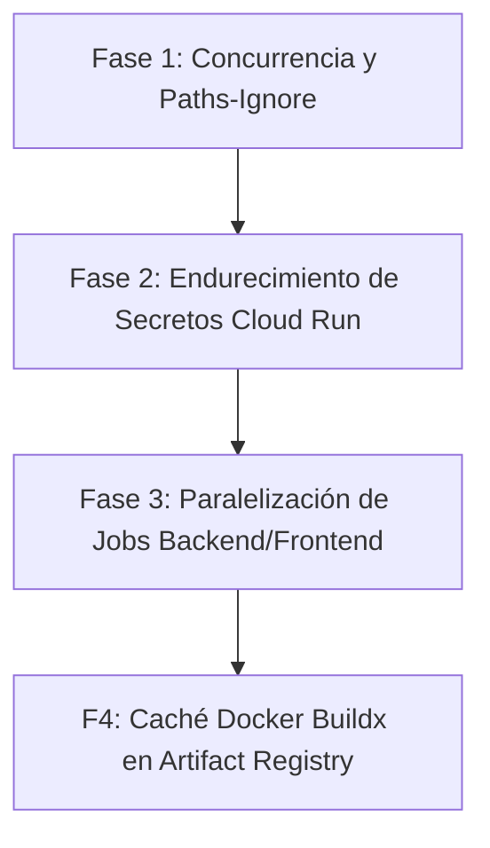

# 🚀 PLAN DE OPTIMIZACIÓN Y ENDURECIMIENTO DE CI/CD (`deploy.yml`)
**Plataforma Sísmica de Centroamérica — Fozna Solutions B.V.**

---

## 🎯 Objetivo
Transformar el pipeline de despliegue en Google Cloud Run (`.github/workflows/deploy.yml`) en un flujo de trabajo de clase empresarial: más rápido, más seguro, libre de ejecuciones redundantes y con paralelización eficiente.

---

## 📊 Matriz de Mejoras

| # | Mejora | Beneficio Principal | Riesgo / Esfuerzo | Impacto |
| :---: | :--- | :--- | :---: | :---: |
| **1** | **Control de Concurrencia (`concurrency`)** | Cancela builds obsoletos en ramas de desarrollo automáticamente | Muy Bajo / 5 min | Inmediato (Ahorro de costes) |
| **2** | **Filtro de Documentación (`paths-ignore`)** | No ejecuta 5 minutos de runners si solo se modifican archivos `.md` | Nulo / 5 min | Alto (Agilidad) |
| **3** | **Secretos Nativos en Cloud Run (`--set-secrets`)** | La contraseña de PostgreSQL nunca viaja por CLI ni se expone en consola | Bajo / 15 min | Crítico (Seguridad) |
| **4** | **Paralelización de Jobs (Backend / Frontend)** | Ejecuta pruebas de Java y Angular a la vez en dos máquinas independientes | Medio / 30 min | Máximo (Velocidad 50%+) |
| **5** | **Caché de Capas Docker (`docker/build-push-action`)** | Reutiliza capas no modificadas de backend y frontend en Artifact Registry | Bajo / 20 min | Alto (Builds en 20s) |

---

## 🛠️ Detalle de las Fases de Implementación



---

### 🔹 FASE 1: Concurrencia y Filtrado de Disparadores
**Objetivo:** Evitar carreras de ejecución y disparos innecesarios.

#### 1.1. Control de Concurrencia
Se agrega en la cabecera de `.github/workflows/deploy.yml`:
```yaml
concurrency:
  group: ${{ github.workflow }}-${{ github.ref }}
  cancel-in-progress: ${{ github.ref != 'refs/heads/main' }}
```
* **Comportamiento:** Si se suben 2 commits consecutivos a `develop`, la primera ejecución se cancela al instante. Si se está desplegando a `main` (producción), nunca se cancela.

#### 1.2. Ignorar Documentación
```yaml
on:
  push:
    branches: [main, develop]
    paths-ignore:
      - '**.md'
      - 'docs/**'
      - 'LICENSE'
      - '.gitignore'
  pull_request:
    branches: [main, develop]
    paths-ignore:
      - '**.md'
      - 'docs/**'
      - 'LICENSE'
      - '.gitignore'
```

---

### 🔹 FASE 2: Endurecimiento de Secretos en Cloud Run
**Objetivo:** Cero exposición de credenciales de base de datos en texto plano.

#### 2.1. Sustitución de Inyección en Bash por Enlace Nativo
En el paso de despliegue del Backend:
```diff
- DB_PASS=$(gcloud secrets versions access latest --secret=db-password --project=${{ env.PROJECT_ID }})
  gcloud run deploy ${{ env.BACKEND_SERVICE }} \
    ...
-   --set-env-vars="SPRING_DATASOURCE_URL=jdbc:postgresql://${DB_IP}:5432/sismos_db,SPRING_DATASOURCE_USERNAME=sismos_app,SPRING_DATASOURCE_PASSWORD=${DB_PASS}" \
+   --set-env-vars="SPRING_DATASOURCE_URL=jdbc:postgresql://${DB_IP}:5432/sismos_db,SPRING_DATASOURCE_USERNAME=sismos_app" \
+   --set-secrets="SPRING_DATASOURCE_PASSWORD=db-password:latest" \
```
* **Resultado:** La cuenta de servicio de Cloud Run (`sismos-backend`) obtiene el valor directamente de Secret Manager en memoria. En la consola web de GCP y en el historial de comandos, la contraseña ya no es visible.

---

### 🔹 FASE 3: Paralelización de Pruebas Unitarias y Calidad
**Objetivo:** Reducir a la mitad el tiempo de espera en Pull Requests y Pushes.

#### 3.1. División del Job `test` en Dos Nodos Paralelos
Actualmente se ejecutan secuencialmente en una sola máquina. Se reorganizarán en:
1. **`test-backend`:**
   * Java 21 Temurin + Maven Cache.
   * `mvn clean test jacoco:report -B`.
   * Gitleaks secret scan.
2. **`test-frontend`:**
   * Node.js 20 + NPM Cache.
   * `npm ci` ➔ `npm run lint` ➔ `npm run build`.
3. **`test` (Agregador Inmutable / Check Gate):**
   * Un job ultrarrápido que espera a ambos: `needs: [test-backend, test-frontend]`.
   * **Ventaja clave:** Cumple con la regla existente de Branch Protection de GitHub sin romper nada.

---

### 🔹 FASE 4: Aceleración de Imágenes Docker con Caché en GitHub
**Objetivo:** Reducir el tiempo de empaquetado de 2-3 minutos a menos de 30 segundos.

#### 4.1. Configuración de Buildx y Cache GHA
```yaml
- name: Set up Docker Buildx
  uses: docker/setup-buildx-action@v3

- name: Build and push Backend Image
  uses: docker/build-push-action@v5
  with:
    context: ./backend
    push: true
    tags: |
      ${{ env.ARTIFACT_REPO }}/backend:${{ github.sha }}
      ${{ env.ARTIFACT_REPO }}/backend:latest
    cache-from: type=gha
    cache-to: type=gha,mode=max
```

---

## 📋 Plan de Ejecución Recomendado

1. **Paso 1 (Inmediato):** Aplicar las **Fases 1 y 2** (`concurrency`, `paths-ignore` y `--set-secrets`). Son cambios no disruptivos que ofrecen seguridad y ahorro inmediato.
2. **Paso 2 (Validación):** Probar en la rama `develop` para verificar que el despliegue automático a TEST funciona con los nuevos parámetros.
3. **Paso 3 (Opcional):** Aplicar la **Fase 3** (paralelización) para optimizar la velocidad de feedback del equipo.

---
*Documento de optimización generado para Fozna Solutions B.V.*
